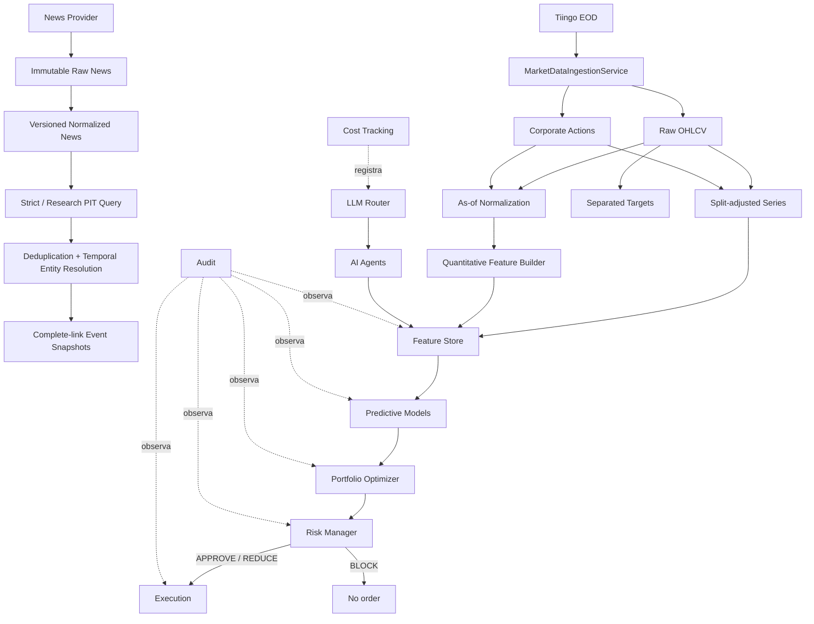

# Arquitectura

## Flujo principal

La información se obtiene y transforma antes de predecir. Una predicción no es una orden: el optimizador propone, el Risk Manager decide y solo una propuesta aprobada o reducida puede llegar a ejecución.

## Responsabilidad por paquete

| Paquete | Responsabilidad | Estado |
|---|---|---|
| `core` | Configuración, tiempo, excepciones, enums y logging | Funcional |
| `data.schemas` | Contratos point-in-time y FeatureRow | Funcional |
| `data.sources` | Contrato de fuentes y adapter Tiingo EOD | Funcional para Tiingo |
| `data.ingestion` | Orquestación incremental, validación y normalización | Funcional Phase 1A |
| `data.calendar` | Sesiones, aperturas y cierres XNYS | Funcional |
| `data.normalization` | Corporate actions y ajuste explícito por splits | Funcional |
| `data.corporate_actions` | Detección y exclusión auditable de eventos complejos | Funcional Phase 1D.1 |
| `data.storage` | Persistencia idempotente Parquet y consulta DuckDB | Funcional básico |
| `data.validation` | Invariantes temporales y feature/target | Funcional |
| `data.pilot` | Orquestación y diagnóstico no destructivo del piloto real | Funcional Phase 1C |
| `data.news_ingestion` | Captura raw, normalización versionada y rebuild de noticias | Implementado Phase 4A; piloto real local disponible (905 revisiones, 811 artículos) |
| `data.news_grouping` | Entidades temporales, grupos editoriales y snapshots complete-link | Phase 4B completed_with_documented_limitations; v1.1 opt-in candidata |
| `features` | Transformaciones cuantitativas, builder as-of y targets separados | Funcional Phase 1B |
| `agents` | Contexto/respuesta común y agentes especializados | Contratos/stubs |
| `llm` | Router, clientes, pricing, costos y cache | OpenAI Responses opt-in; otros clientes stub; presupuestos/telemetría explícitos |
| `models` | Datasets temporales, preprocessing, métricas, selección, robustez y holdout one-shot | Funcional hasta Phase 3E.2; resultado final marginal registrado |
| `portfolio` | Estado, forecasts, propuestas y optimizador | Contrato |
| `risk` | Límites y decisión independiente | Funcional básico |
| `backtesting` | Motor temporal, métricas, benchmark y baselines sistemáticos | Funcional Phase 2B; validación real completa en el universo fijo actual |
| `execution` | Órdenes, fills y paper executor | Contrato/stub |
| `audit` | Registro reconstruible de decisiones | Funcional básico |

## Dependencias permitidas

- `core` no depende de capas de negocio.
- `data` puede depender de `core`; no depende de agentes, modelos, cartera ni ejecución.
- `features` depende de schemas/datos y librerías numéricas; no depende de modelos o ejecución.
- `agents` depende de sus contratos, datos disponibles y la abstracción LLM; no de portfolio, risk o execution.
- `llm` es infraestructura transversal y no decide inversiones.
- `models` consume features, no documentos crudos ni outputs de ejecución.
- `portfolio` consume forecasts y estado, no llama agentes o proveedores.
- `risk` puede validar propuestas de portfolio y estado/medidas de riesgo; no depende de LLM.
- `execution` consume únicamente órdenes derivadas de una decisión de riesgo autorizada.
- `audit` puede registrar resultados de todas las etapas, pero ninguna etapa debe depender de audit para su lógica financiera.

Dependencias prohibidas: `agents → execution`, `llm → execution`, `models → data.sources`, `execution → agents`, y cualquier ruta que evite `risk`. Los targets tampoco pueden fluir hacia agentes, inferencia o optimización.

Los aliases viven en `config/provider_symbols.yaml`: solo el adapter traduce la
request y toda salida conserva el ticker interno. Los eventos complejos viven en
una tabla processed separada. Sus flags de features están limitados por
`known_at`; los flags de targets pueden mirar dentro del horizonte futuro y no
retornan al flujo de inferencia.

## Almacenamiento

Parquet es el formato durable inicial para raw, processed y features. DuckDB consulta estos archivos localmente sin introducir un servicio de base de datos. El cache de análisis usa archivos JSON identificados por `source_id`, hash de contenido y versión de análisis. La auditoría inicial usa JSON Lines. Esta elección es adecuada para una fase local y testeable; escalar infraestructura requiere una necesidad demostrada y un ADR.

Phase 4A mantiene noticias fuera del Feature Store: payloads content-addressed e
inmutables bajo `data/raw/news`, metadata de capturas separada y revisiones
normalizadas en `data/processed/news/news-schema-v1/data.parquet`. `news_id`
identifica `provider + provider_news_id`; `revision_id` identifica una versión
de contenido y la clave física agrega schema/normalizer. Una consulta estricta
usa exclusivamente disponibilidad respaldada de la revisión. Una consulta
histórica solo puede usar `historical_proxy_at` con opt-in explícito y el proxy
permanece marcado como no verificado. La revisión vigente se selecciona antes de
aplicar filtros por ticker. `direct_tickers` proviene solo del proveedor;
`request_tickers` permanece en el lineage raw. ADR-023 fija hashes, timestamps,
lineage y rebuild.

Phase 4B consume solo revisiones elegibles de esa API y persiste sus resultados
en `data/processed/news_enrichment`, sin modificar Phase 4A. El registry distingue
entidad corporativa, security, ticker, alias, vigencia y `known_at`. Deduplicados
editoriales y eventos compartidos conservan contratos separados; el clustering
exige compatibilidad entre todos los miembros. Cada snapshot identifica inputs,
registry y configuración por SHA-256 y separa `computed_at` de disponibilidad.
ADR-024 y `docs/news-groups.md` describen la reconstrucción strict/research.

Phase 4B.1 añade una herramienta de auditoría bajo `audit.news_semantic_review`.
Lee/reconstruye snapshots usando los contratos existentes, prepara evidencia
ciega y predicciones por separado y calcula métricas solo tras adjudicación
externa completa. Los archivos con contenido viven en una carpeta local
explícitamente ignorada; el reporte publicable contiene solo metadatos
sanitizados. No cambia algoritmos, thresholds, registry ni contratos de 4B.

`MarketDataIngestionService` consulta el último dato local, aplica overlap, obtiene barras desde el adapter, valida, extrae acciones, hace upsert y reconstruye la serie latest-basis. La estructura física es `raw/tiingo/daily`, `raw/tiingo/corporate_actions` y `processed/market/split_adjusted_latest`. Los archivos permiten reconstruir provider, ingestión, schema, normalización, ticker y rango.

La capa processed no usa los campos `adj*` del proveedor como fuente de verdad. Los conserva en raw para comparación, pero deriva su propia serie reproducible solo con splits. Latest-basis sirve para exploración y auditoría; decisiones históricas deben construir una vista as-of que filtre barras y acciones por disponibilidad. Véanse ADR-007 y ADR-008.

Phase 4B.2 agrega dispatch versionado v1/v1.1 para equivalencias editoriales
acotadas (ADR-025). Conserva contratos/PIT, blocking y complete-link. Snapshots
y nueva evidencia ciega quedan en un árbol local separado e ignorado;
los 36 casos anteriores pasan a desarrollo sin alterar archivos originales.
Véase `docs/phase4b2-review.md` y `docs/phase4b-closure.md`: cierre técnico
autorizado con limitaciones; 4B `completed_with_documented_limitations`,
4B.1 `completed_ai_assisted_semantic_review`, 4B.2 `completed_targeted_improvement`.
v1 conserva defaults/snapshots y v1.1 sigue candidata opt-in, sin promoción
automática. ADR-024/025 y evidencia histórica no se reescriben.

ADR-026 fija la interpretación para futuros consumidores: compartir ticker,
empresa, tema o fecha no prueba compartir acontecimiento; clusters no certifican
semántica exhaustiva. Recopilaciones multievento pueden relacionarse parcialmente
con artículos sin justificar deduplicación/agrupación automática. Una futura
4C deberá aceptar artículos individuales, preservar lineage/incertidumbre/PIT
y no asumir recall completo. Ese cierre no inició Phase 4C.

La autorización posterior de 4C.1 añade exclusivamente contratos bajo
`agents.news_interpretation`: request individual as-of, eventos múltiples,
interpretación económica con fact/inference/unknown y replay de LLMResponse
simulada. Reutiliza LLMRequest sin cambiar router/clientes/NewsAgent ni Phase 4B.
No hay llamada de inferencia ni conexión a features. Las citas usan offsets
exactos; el texto es dato no confiable, no instrucción. Snapshot de contexto
computado después del corte no es conocimiento histórico estricto.

El resultado separa disponibilidad de evidencia, generación, validación y
disponibilidad derivada; todo replay 4C.1 es experimental, nunca operativo.
ADR-027 y `docs/phase4c1-review.md` documentan versiones/fingerprints,
abstención, límites de validación semántica y evaluación externa previa a modelos.
4C.1 fue aceptada como `completed_with_documented_limitations`; sus contratos,
protocolo y evidencias históricas se preservan. La autorización posterior de
4C.2 añade OpenAIClient opt-in/Responses vía el mismo router, reservas SQLite
durables de presupuesto, telemetría con desconocidos explícitos y wrapper de
intentos inmutables bajo `data/cache/news_interpretation`. AnalysisCache es un
índice, no evidencia mutable. Strict JSON de transporte no sustituye validación
Pydantic/citas/PIT. LLMRequest conserva hashes históricos excluyendo su hint
opcional de schema de serialización; el wire efectivo se registra por separado.
ADR-028 fija parámetros/modelos/precios explícitos, TTL/reintentos/secretos.
ADR-029 añade un perfil opt-in v2 con escrituras de caché separadas y
`reasoning.effort` anidado; conserva manifest/attempt v1 y replay 4C.1.
La CLI de smoke exige cuatro tarifas y un intento; `--validate-only` comparte
preparación/reserva sin llamadas ni persistencia. Véase
`docs/phase4c2-smoke-preparation.md`; el primer smoke continúa sin ejecutar.
ADR-030 centraliza `.env` de la raíz del repositorio tras autorización real,
sin override ni carga en imports, loaders YAML, tests o modos offline. Los
clientes/agentes/router no cargan credenciales; presupuestos y PIT se conservan.
4C.2: `implemented_pending_external_review`; smoke no ejecutado; 4C.3 `not_started`.
Sin Feature Store ni señales operativas; no se modifican algoritmos 4B.

## Point-in-time y Feature Store

Los schemas preservan cuatro timestamps con semánticas distintas. `available_at <= decision_time` se valida antes de usar registros. El Feature Store tiene granularidad `ticker + decision_date`; los joins deben respetar disponibilidad y nunca usar la última revisión conocida hoy para simular una decisión pasada.

Features y targets tienen registros y persistencia separados conforme a ADR-009. `model_features()` expone solo inputs. Labels se construyen en `features.targets` y solo se unen a features por `ticker + decision_date`, con cardinalidad one-to-one, mediante el builder supervisado. Los targets 5/10/20 persisten su sesión final exacta como metadata y nunca la exponen en `X`.

Phase 3A define un fixed holdout por `decision_date`: train 2010-01-04–2018-12-31, validation 2019-01-02–2021-12-31 y test desde 2022-01-03. Antes de una frontera, solo sobrevive un label cuyo `target_end_date < next_split_start`. Un embargo opcional y separado elimina las primeras N sesiones XNYS del split posterior; su valor V1 es cero. Todas las filas de una fecha permanecen en el mismo split. El contrato OOS de predicción termina en forecasts y no contiene allocations, riesgo ni execution.

Phase 3B usa un contrato de selección que expone únicamente TRAIN y VALIDATION;
TEST 2022+ no entra al runner. `quantitative-baseline-v1` es una allowlist fija
de 52 features y `baseline-standard-v1` ajusta transformaciones deterministas,
medianas y StandardScaler solo en TRAIN. OLS, Ridge, Logistic L2 y baselines
ingenuos se comparan con métricas pooled y cross-sectional por fecha/año. Sus
artefactos son predicciones exclusivas de validation, parámetros de
preprocessing y coeficientes auditables; no son forecasts liberados hacia
portfolio ni backtesting. ADR-015 fija estas decisiones.

Phase 3C reutiliza exactamente ese contrato, split, feature set y Target Store.
`tree-preprocessing-v1` conserva los dos `log1p`, ajusta medianas solo en TRAIN,
registra/excluye constantes y no escala. Los perfiles fijos de Random Forest,
XGBoost y LightGBM se seleccionan dentro de familia y luego entre familias con
tolerancias predeclaradas, métricas por año y desempate por complejidad. Los
rankings derivados reutilizan predicciones de regresión; no son fits nuevos.
Las importancias nativas y por permutación son diagnósticas sobre VALIDATION y
no retroalimentan features ni modelos. ADR-016 fija estas decisiones.

Phase 3D.1–3D.4 añade un runner `robustness-selection` que sólo recibe datos
label-safe hasta 2021. Cada período reconstruye un expanding TRAIN desde
2010-01-04, purga toda fila con `target_end_date_20d >= prediction_start` y crea
un preprocessor nuevo. Los schedules monthly/quarterly/semiannual/annual se
derivan de sesiones XNYS y congelan modelo/preprocessing entre activaciones.
Las políticas generan predicted-return ranking continuo, métricas anuales,
coste de fit y diagnóstico de edad sin mezclar políticas como observaciones
independientes. ADR-017 fija estas decisiones. No existe integración con
portfolio, risk, execution ni TEST.

Phase 3D.5 reutiliza ese contrato con RF-Small y annual congelados. El módulo de
sensibilidad calcula por activación un inicio expanding o trailing de 8/5 años
calendario, con floor 2010-01-04, y aplica después el mismo purge estricto. Cada
política conserva métricas y preprocessing separados; nunca se apilan sus
predicciones como observaciones económicas independientes. La reproducción del
expanding previo es una compuerta obligatoria antes de seleccionar o interpretar.
ADR-018 fija expanding como política de desarrollo actual; TEST sigue fuera del
runner y de los artefactos.

Phase 3D.6 añade una taxonomía auditable y disjunta de diez familias sobre las
52 features canónicas. Cada política elimina exactamente una familia, reconstruye
un `TreePreprocessor` sobre el subset y reutiliza annual/expanding con el mismo
purge. Las series de políticas no se apilan como observaciones independientes.
La clasificación es diagnóstica: no muta `quantitative-baseline-v1`, no dispara
una segunda ronda y no selecciona el candidato final. ADR-019 registra la
taxonomía y la conclusión actual; TEST permanece fuera del runner.

Phase 3D.7 no ejecuta modelos ni carga datasets: consolida summaries 3B–3D.6,
verifica la cadena de reproducción y emite un contrato machine-readable. El
fingerprint SHA-256 cubre todas las dimensiones predictivas congeladas y excluye
provenance volátil. `ready_for_holdout_evaluation` solo puede ser verdadero si
todos los checks pasan. ADR-020 fija `development-candidate-v1`; cambiar una
dimensión invalida ese ID. El entrenamiento final y la apertura de TEST quedan
fuera de esta fase.

Phase 3E.1 tampoco carga datasets ni ejecuta modelos. Lee únicamente el contrato
congelado y metadata/configuración, fija cutoff nominal 2026-10-05 y fingerprints
de snapshot/protocolo. ADR-021 predeclara walk-forward XNYS annual/expanding,
purge dinámico estricto, métricas, controles Ridge-100 y `momentum_20d`, umbrales
y semántica one-shot. La fecha efectiva label-safe quedó reservada para la
ejecución explícita de 3E.2; en ese punto todavía regían `test_used=false`,
`test_opened=false` y `holdout_executed=false`.

Phase 3E.2 persistió el opening record antes de leer TEST y ejecutó cinco fits
annual/expanding de RF-Small y cinco de Ridge-100 hasta la fecha efectiva
2026-09-03. RF obtuvo mean Rank IC 0.056579, pero el worst-year IC 2022 de
-0.046739 impidió PASS y produjo status `marginal`. ADR-022 registra el resultado
sin alterar candidato, protocolo ni thresholds. TEST está abierto y cualquier
rerun futuro solo puede ser una reproducción exacta; no puede alimentar nueva
selección bajo la misma generación.

El builder agrupa fechas consecutivas cuyo conjunto de splits elegibles no cambia. También abre un nuevo segmento cuando una barra histórica retrasada del activo o SPY pasa a estar disponible. Para cada segmento construye una sola vista as-of hasta su fecha final, calcula rolling features vectorizadas y conserva únicamente sus filas. Barras futuras con fecha posterior son causalmente inocuas; una barra retrasada con fecha histórica no lo es y por eso constituye un límite.

Los límites de segmentos y `history_count` se derivan de eventos de disponibilidad y búsquedas sobre cutoffs precomputados; no se vuelve a escanear todo el histórico por cada fecha de decisión. Los factores de splits futuros se calculan mediante productos acumulados por ticker y fecha efectiva. Estas optimizaciones preservan las reglas causales y tienen regresiones contra implementaciones ingenuas.

Features se almacenan por año en un archivo Parquet consolidado. Un rebuild reemplaza autoritativamente todos los registros de los tickers y rango solicitados antes de insertar el resultado, eliminando filas obsoletas sin afectar otros rangos o activos. Targets usan la misma política en otra raíz. DuckDB puede consultar `year=*/data.parquet` con hive partitioning. Un cambio histórico de corporate actions, disponibilidad, cutoff, calendario, fórmula o versión exige reconstruir el período afectado; cambios de splits pueden justificar full rebuild del ticker.

Phase 1C añade una capa de pilotaje, no una nueva metodología financiera. `RealDataPilot` reutiliza ingesta, stores y builder existentes; mide cobertura y rendimiento, reconstruye ventanas as-of alrededor de splits y bloquea el resultado si falla una comprobación temporal. Su JSON de reporte es evidencia diagnóstica, no una entrada de features ni de entrenamiento.

Phase 1D amplía esa orquestación al universo fijo configurado. Los errores recuperables se aíslan por ticker, la ingesta puede reanudarse omitiendo coberturas locales completas y el ranking se calcula conjuntamente solo sobre activos invertibles; SPY continúa siendo benchmark de entrada y no participa en el ranking.

## Backtesting y accounting histórico

`backtesting.schemas` define contratos históricos separados de los contratos
conceptuales basados en pesos de `portfolio` y de la ejecución futura. Una
`TargetAllocation` sigue siendo una intención de pesos, mientras
`SimulatedOrder` y `SimulatedFill` representan unidades. Esta separación no
autoriza una ruta que omita al Risk Manager cuando se implemente el loop.

`PortfolioLedger` mantiene cash y posiciones long-only de forma determinista.
Los fills usan precios raw; `fill_price` incorpora slippage y las comisiones se
cargan directamente a cash. El P&L realizado usa costo promedio y el no realizado
se calcula en cada snapshot. Splits cambian quantity y average cost usando la
convención acciones nuevas/antiguas, y dividendos acreditan cash explícitamente.

`HistoricalBacktestEngine` recibe allocations por fecha y no conoce estrategias,
modelos ni optimizadores. Recorre sesiones XNYS y, en cada sesión, aplica este
orden: corporate actions complejas y splits pre-open; captura del entitlement de
dividendos; fills pendientes en raw open; mark-to-market en raw close; crédito de
dividendos; snapshot final a las 20:15 ET; y nuevas órdenes para la apertura de
la sesión siguiente. Las ventas preceden a las compras. Un open ausente deja la
orden `UNFILLED` sin rollover; un close ausente puede reutilizar exclusivamente
el último precio de valoración y queda marcado como stale.

Con acciones fraccionales deshabilitadas, un split liquida la fracción al raw
open post-split como aproximación auditable de cash-in-lieu. Si falta ese precio,
el run falla. Tiingo EOD `divCash` se interpreta como ex-date: la cantidad elegible
se captura después de splits y antes de cualquier fill, mientras el cash se
acredita después del cierre porque la fuente no garantiza payment date. Una
acción compleja no modelable en una posición mantenida invalida el run; nunca se
inventa continuidad económica.
Estas semánticas se fijan en ADR-011.

ADR-013 permite una excepción estrictamente event-specific: un registro tipado y
versionado puede transformar holdings/cash cuando existe evidencia primaria. El
registro separa entitlement, fecha económica y procesamiento pre-open; consume
los componentes split/dividend con que el proveedor haya representado el mismo
evento para no duplicarlos. Sin treatment compatible, el evento sigue fallando.
Las transformaciones nunca reescriben OHLCV raw ni precios históricos.

Para spin-offs con due bills, `record_date` conserva la fecha legal y
`entitlement_date` identifica cuándo el engine observa la propiedad económica.
Como no existen mercados ex-distribution ni when-issued en el simulador, todo
trade del ticker padre se interpreta regular-way: el derecho acompaña a la
posición hasta el último cierre anterior a la distribución. Una venta posterior
al record date pierde el derecho y una compra regular-way lo adquiere.

Una distribución revisada puede crear uno o más `auxiliary securities` aunque
no estén en
`development_fixed`. El engine carga sus barras raw, lo mantiene y valora, y el
target implícito cero permite venderlo en la siguiente apertura; la estrategia
no lo selecciona ni lo incorpora a elegibilidad. KRFT usa basis no asignado: NAV
permanece completo, pero P&L de trading se marca incompleto y su total no se
publica. ABBV demuestra el caso dual: puede nacer como distribución y seguir
siendo un activo normal de `development_fixed` elegible en fechas posteriores.
Si ya existe una posición del security distribuido, las quantities se combinan
en una sola posición y todo el basis queda conservadoramente no asignado. La
falta de datos de cualquier security requerido bloquea la simulación antes de
mutar el ledger. Una sola `CorporateActionTransformation` enumera todos los
securities distribuidos con quantity y estado de basis propios.

La identidad económica no se deriva únicamente del ticker. Para Google 2014,
Nasdaq trasladó la historia Class A del antiguo `GOOG` al nuevo `GOOGL` y la
historia when-issued Class C `GOOCV` al `GOOG` posterior. Tiingo entrega esa
lineage restated: GOOGL conserva Class A pre-evento y GOOG empieza como Class C
el 2014-03-27. El registry enlaza esas representaciones verificadas sin branches
por ticker ni duplicación de Class A. Los treatments de distribución requieren
raw open válido tanto del parent como del security recibido en processing date.

La historia Tiingo de RTX aplica la misma regla de identidad: contiene el
lineage histórico de UTC desde 2009 y continúa 1:1 tras el rename. El evento de
2020 distribuye simultáneamente CARR 1:1 y OTIS 0.5:1; ambos comienzan localmente
con barras when-issued el 2020-03-19. No se sintetiza `UTX SELL / RTX BUY`. El
ratio 2.3348 de la fusión pertenece al lineage separado de RTN y no participa en
la transformación de una posición UTC/RTX.

Los IDs deterministas enlazan allocation, order y fill. `risk_decision_id` deja
preparado el vínculo futuro, pero Phase 2A.2 no integra Risk Manager: el input del
simulador no constituye una nueva ruta de ejecución y la autoridad definida en
ADR-004 permanece intacta.

La evaluación vive fuera del engine. `backtesting.metrics` contiene funciones
puras cuya fuente de performance es la curva de NAV; `backtesting.reporting`
agrega ejecuciones, costos, turnover, exposición, P&L y corporate actions en un
`BacktestMetrics` JSON-serializable. La metodología versionada es
`backtest-metrics-v2`: conserva las fórmulas de ADR-012 y añade cash de
recapitalización, conteo de treatments y completitud de cost basis según ADR-013.

El benchmark de reporting no es una estrategia de Phase 2B. Es una simulación
interna de SPY con el mismo capital, rango, configuración de costos y semántica
after-close/next-open. Usa raw prices, splits y entitlement de dividendos; el
cash del dividendo se reinvierte mediante una decisión al cierre de ex-date y un
fill en la apertura siguiente. No se usa `adjusted_close` ni información futura.

`backtesting.strategies` genera mappings de fecha a `TargetAllocation`; no llama
al engine ni al reporter. SPY buy-and-hold comparte con el benchmark únicamente
el schedule causal de entrada y reinversión. Equal-weight y momentum consultan
el Feature Store físico mediante columnas explícitas y por `decision_date`; la
API rechaza targets. El engine sigue siendo agnóstico a la estrategia.

Equal-weight rebalancea diariamente todos los activos `model_eligible` del
`development_fixed`, sin el límite V1 de 15 posiciones. Momentum selecciona cada
día hasta 10 activos por `momentum_20d` descendente y ticker ascendente, con 10%
por activo y el resto en cash. Ambos excluyen SPY y heredan el survivorship bias
del universo fijo. No existe integración con Risk Manager en Phase 2B.

## LLM Router, costos y cache

Los agentes envían `LLMRequest` al router, que selecciona cliente y modelo desde configuración. Esto centraliza proveedores, políticas, observabilidad y futuros límites de presupuesto. Cada respuesta debe producir un `LLMCallRecord`, cuyo costo se calcula mediante `PricingRegistry`. El cache permite reutilizar análisis únicamente cuando coinciden contenido y versión.

Los clientes siguen deshabilitados por defecto. OpenAI Responses solo puede
ejecutarse con configuración explícita/opt-in por el router; Ollama permanece
stub. No se ejecutó el smoke real ni se incorporan secrets al repositorio.

## Auditoría

`DecisionAuditRecord` captura el contexto suficiente para responder por qué se produjo una acción: features, modelo, predicción, propuesta, riesgo, resultado, agentes, fuentes y costo. La auditoría registra decisiones; no las altera.

## Por qué los agentes no ejecutan

Un agente LLM procesa texto potencialmente incompleto, conflictivo o malicioso y su salida es probabilística. Darle acceso directo a ejecución mezclaría evidencia con autoridad, impediría imponer límites deterministas y haría difícil reconstruir responsabilidades. Separar agentes, optimizador, Risk Manager y execution garantiza que:

- una opinión narrativa no se convierta automáticamente en una orden;
- exposición y límites se apliquen de manera determinista;
- el Risk Manager pueda reducir o bloquear cualquier propuesta;
- errores, prompt injection o fallos de proveedor no tengan acceso al broker;
- auditoría y backtesting reproduzcan cada transformación.

Esta frontera no debe romperse ni siquiera en la fase de ejecución automática.
